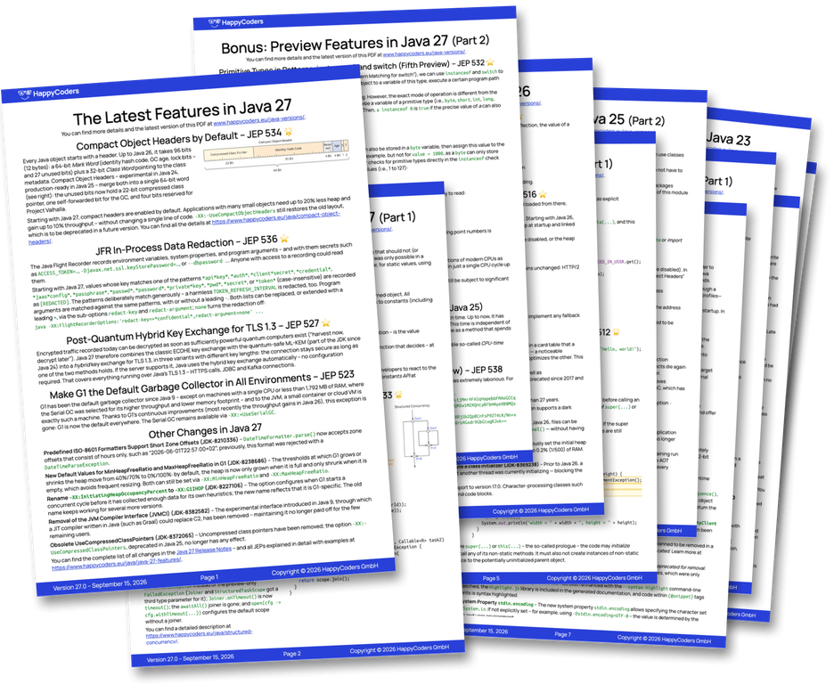
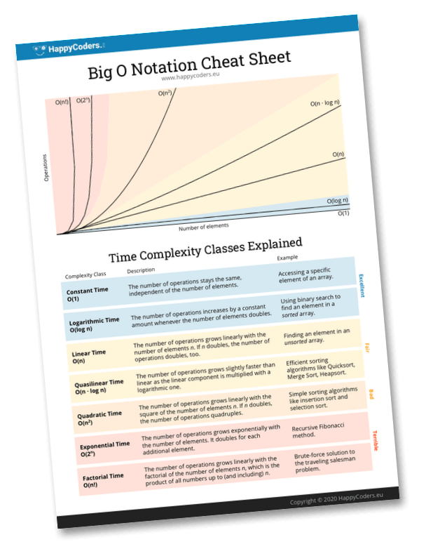

# How to Convert String to Int in Java – Peculiarities and Pitfalls

JMH benchmarks to measure the speed of various methods to convert a String to an int / Integer in Java.

Related article on my blog:
* English: [How to Convert String to Int in Java – Peculiarities and Pitfalls](https://www.happycoders.eu/java/convert-string-to-int-peculiarities-pitfalls/)
* German: [Java: String in int umwandeln – Besonderheiten und Fallstricke](https://www.happycoders.eu/de/java/string-in-int-umwandeln-besonderheiten-fallstricke/)

## Running the series

```
./run-all-jdks.sh --plan   # what would run, with estimated clock times
./run-all-jdks.sh          # the whole series
```

The script resolves the JDKs (8, 11, 17, 21, 22, 23, 24, 25, 27) from the
SDKMAN candidates and skips the ones that are not installed. One jar, built
with `--release 8`, runs unchanged on every JDK – nothing in the measured
path depends on the compiler.

| Run | Methods | Result file |
|---|---|---|
| series, every JDK | the five `integerParsePositiveInt*` variants | `results/java<N>.json` |
| all methods, newest JDK | all eight of `StringToIntMultiBenchmark` | `results/java<N>-all-methods.json` |

Every run uses 3 forks × (5 warmup + 5 measurement) × 5 s per method, JMH's
GC profiler (bytes per operation), and `-Djmh.blackhole.autoDetect=false`, so
that every JDK measures with the same blackhole. `--majors` restricts a run;
`JMH_OPTS` in the environment overrides the JMH settings.

## The 2019 results

`results/result_java*.txt` are the measurements the article was originally
based on (Java 7 to 14, Dell XPS 15 with an i7-8750H). They were taken with a
`@Setup(Level.Invocation)` state, which JMH documents as unusable for
sub-millisecond operations: it timestamps every invocation, so a 5–20 ns
parse was measured together with two `System.nanoTime()` calls. The
benchmarks now draw their input once per trial (`RandomNumberStrings`), and
the current measurements live with the article's other data in the website
repository.

Happy Coding!


<!-- happycoders-resources:start -->
<!-- Generated from happycoders-website-astro/data/github-readme by scripts/content/sync-github-readmes.mjs. Edit there, not here. -->

## <br>Additional Resources

### <br>Java Versions PDF Cheat Sheet

**Stay up-to-date** with the latest Java features with this **free** [PDF Cheat Sheet](https://www.happycoders.eu/java-versions/)!

[](https://www.happycoders.eu/java-versions/)

* Avoid lengthy research with this **concise overview of all Java versions from Java 10 to Java 27**.
* **Discover the innovative features** of each new Java version, summarized on a single page.
* **Impress your team** with your up-to-date knowledge of the latest Java version.

👉 [Download the free Java Versions PDF](https://www.happycoders.eu/java-versions/)<br>

_(Hier geht's zur deutschen Version &rarr; [Java-Versionen PDF](https://www.happycoders.eu/de/java-versionen/))_


### <br>The Big O Cheat Sheet

With this **free** [1-page PDF cheat sheet](https://www.happycoders.eu/big-o-cheat-sheet/), you'll always have the **7 most important complexity classes** at a glance.

[](https://www.happycoders.eu/big-o-cheat-sheet/)

* **Always choose the most efficient data structures** and thus increase the performance of your applications.
* **Be prepared for technical interviews** and confidently present your algorithm knowledge.
* **Become a sought-after problem solver** and be known for systematically tackling complex problems.

👉 [Download the free Big O Cheat Sheet](https://www.happycoders.eu/big-o-cheat-sheet/)<br>

_(Hier geht's zur deutschen Version &rarr; [O-Notation Cheat Sheet](https://www.happycoders.eu/de/o-notation-cheat-sheet/))_


### <br>HappyCoders Newsletter
👉 Want to stay on top of modern Java?
Sign up for the [HappyCoders newsletter](https://www.happycoders.eu/newsletter/) – Modern Java: new versions & features, performance, and JVM insights – once a month.

_(Hier geht's zur deutschen Version &rarr; [HappyCoders-Newsletter deutsch](https://www.happycoders.eu/de/newsletter/))_


### <br>🇩🇪 An alle Java-Entwickler:innen, die durch fundierte Kenntnisse über Datenstrukturen besseren Code schreiben wollen

Trage dich jetzt unverbindlich auf die [Warteliste](https://www.happycoders.eu/de/mastering-data-structures-warteliste/) von „Mastering Data Structures in Java“ ein, und erhalte das beste Angebot!

[](https://www.happycoders.eu/de/mastering-data-structures-warteliste/)

👉 [Zur Warteliste](https://www.happycoders.eu/de/mastering-data-structures-warteliste/)
<!-- happycoders-resources:end -->
